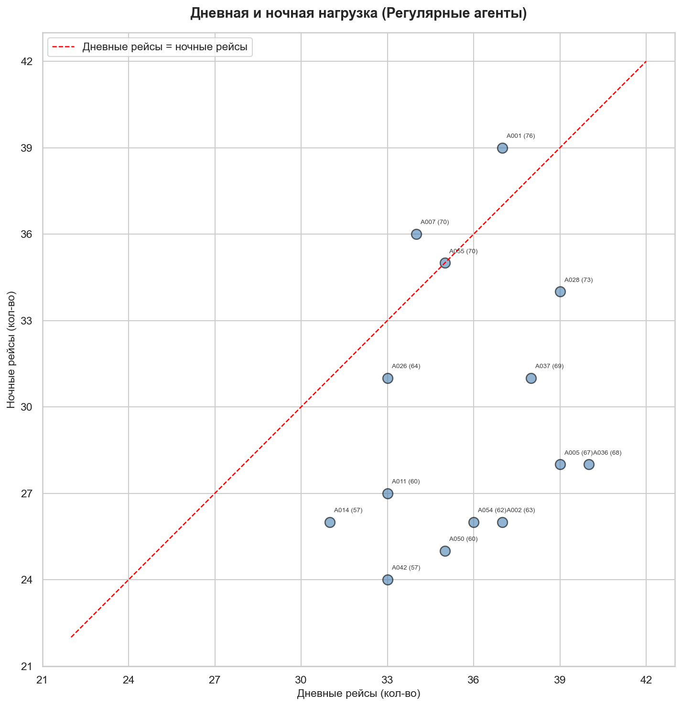

# Выводы
#### 1. Нагрузка распределена неравномерно, но не критично
При равных условиях (одинаковое число смен, только агенты, работающие в основном составе смены) разрыв между топ и аутсайдером составляет **19 рейсов** (76 у `A001` против 57 у `A014` и `A042`) и **~1231 зарегистрированных пассажиров** (4146 у `A001` против 2915 у `A005`).
Средний перерыв между рейсами внутри смены колеблется от **78 минут** `A055` до **107 минут** `A042`. Разрыв 29 минут. Это меньше, чем предполагалось изначально, но говорит о том, что перекос в перерывах существует.

***Гипотеза №1** "Нагрузка распределена неравномерно. Одни агенты обслуживают в разы больше пассажиров, чем другие" и **Гипотеза №3** "Перерывы распределены неравномерно между агентами" - **Подтверждены частично**.*

Из 14 агентов основного состава (с числом смен > 10):
- **8 агентов** (57%) владеют **5+ DCS** — `A026` (6), `A007, A011, A014, A028, A037, A042, A050` (по 5).
- **5 агентов** (36%) имеют допуск уровня **Expert DCS** — `A026` (2 системы), `A007, A014, A042, A054` (по 1).
- Базовый уровень Basic DCS (2 системы) есть у всех — это обязательный минимум.
- Medium DCS: от 0 `A001` до 3 `A011, A028, A037, A050`.

***Гипотеза №2** "Сложные и разнообразные рейсы закреплены за узкой группой агентов" - **Подтверждена**.*

Часть агентов работает преимущественно в дневные смены:

| Агент | День (рейсы) | Ночь (рейсы) | Разница (Д-Н) | Кол-во отработанных смен Д,Н |
|---|---|---|---|---|
| A014 | 31 | 26 | 5 | 7, 7 |
| A042 | 33 | 24 | ***9*** | 7, 7 |
| A054 | 36 | 26 | ***10*** | 7, 6 |
| A011 | 33 | 27 | *6* | 7, 6 |
| A050 | 35 | 25 | ***10*** | 7, 7 |
| A002 | 37 | 26 | ***9*** | 7, 6 |
| A036 | 40 | 28 | ***12*** | 7, 7 |
| A037 | 38 | 31 | *7* | 7, 7 |
| A028 | 39 | 34 | 5 | 7, 7 |
| A055 | 35 | 35 | ***0*** | 7, 6 |
| A001 | 37 | 39 | ***-2*** | 7, 7 |
| A007 | 34 | 36 | 2 | 7, 7 |

*Точки выше красной линии - «ночные» агенты, ниже - «дневные»* ([scatterplot.ipynb](../Python/scatterplot.ipynb)).

У топовых (по общему количеству рейсов) агентов `A001, A007, A055` нагрузка сопоставима в обе смены. `A055` работает ровно 35/35, а `A001` и `A007` немного больше в ночные смены. При этом агенты `A042, A050, A036` имеют значительно меньше рейсов именно в ночные смены, хотя их дневная нагрузка не выше, чем у топов.

***Гипотеза №4** "В ночную смену работают одни агенты, в дневную — другие" - **Подтверждена**.*

#### 2. Extra-агенты оправданы, но назначаются неравномерно

Сравнение плановой потребности (норматив 1 агент на 50 пассажиров) с фактическим составом:

| Статус рейса | Рейсов | Доля |
|---|---|---|
| Нехватка даже с Extra | 417 | 61,7% |
| Укомплектован без Extra | 211 | 31,2% |
| Extra закрыли нехватку | 34 | 5,0% |
| Избыток агентов | 14 | 2,1% |

Extra-агенты **закрывают нехватку только в 5% случаев**. Ещё 2% — избыток. При этом 62% рейсов не хватает персонала даже с учётом extra.

Это значит, что extra-агенты привлекаются, но **не туда, где они нужны больше всего и не в том количестве**.

***Гипотеза №5** "Привлечение extra-агентов не оправдано" - **Не подтверждена**.*

#### 3. Пик нагрузки приходится на ночные смены
Самый загруженный 4-часовой интервал **02:00–05:59** ~1911 пассажиров за смену. Ночной пик объясняется массовыми вылетами в 06:00–09:00. Регистрация на них открывается за 3 часа — то есть в 03:00–06:00, что и создаёт концентрацию пассажиров в 02:00–05:59. Дневной пик **10:00–13:59** ~1216 пассажиров. Для сравнения: минимальный интервал **22:00–01:59** ~639 пассажиров, то есть в 3 раза меньше ночного пика.

***Гипотеза №6** "Распределение нагрузки по пассажиропотоку неравномерно. Максимум пассажиров приходится на ночные часы" - **Подтверждена**.*

#### 4. Конфликты стоек носят системный характер

Из 49 стоек конфликты (наложения регистраций двух рейсов на одну стойку в рамках одной смены) зафиксированы на **30 стойках**. Но 60% всех конфликтов приходится на 6 стоек:

| Стойка | Конфликтов | Всего рейсов | % Конфликтов |
|---|---|---|---|
| 47 | 19 | 63 | 30,2% |
| 33 | 14 | 60 | 23,3% |
| 34 | 14 | 61 | 23,0% |
| 45 | 12 | 79 | 15,2% |
| 44 | 11 | 78 | 14,1% |
| 49 | 11 | 66 | 16,7% |

Конфликты сконцентрированы не случайно. Стойки 45–47 обслуживают рейсы крупнейшего перевозчика, 33–36 базовую авиакомпанию, а 49 находится — на стыке нескольких перевозчиков. Наложения системны, потому что высокая частота рейсов одной авиакомпании создаёт конкуренцию за стойки.

Каждый третий рейс на стойке 47 проходит с наложением*.

*Наложение определяется по пересечению интервалов регистрации. Если два рейса регистрировались на одной стойке в разное время, но с одним агентом — это не конфликт, а плановая ротация. Такие случаи из анализа исключены.

***Гипотеза №7** "Конфликты стоек носят системный характер" - **Подтверждена**.*

#### 5. Стойки используются коллективно, закрепления нет

По всем стойкам с загрузкой >50 рейсов:
- Доля топ-агента на стойке — **9–18%**.
- На каждой стойке работают **16–28 агентов**.
- Среднее число рейсов на агента — **2,5–4,2**.

***Гипотеза №8** «Одни и те же агенты работают на самых загруженных стойках» - **Не подтверждена**.*

Но выявлено, что одни и те же агенты оказываются топ-1 на нескольких стойках — `A048` (стойки 51, 36), `A049` (32, 34), `A021`(49, 33), `A036` (50, 35),`A014` (48). Это не закрепление стоек, а следствие общей неравномерности нагрузки. 
