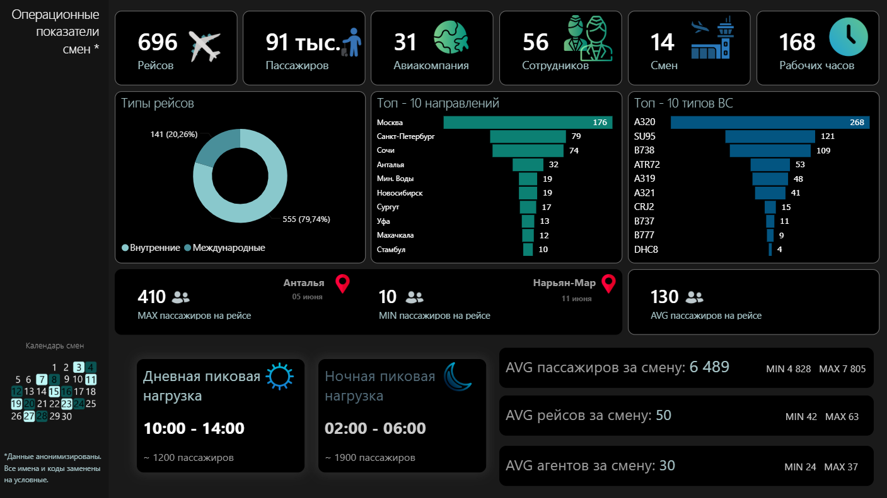
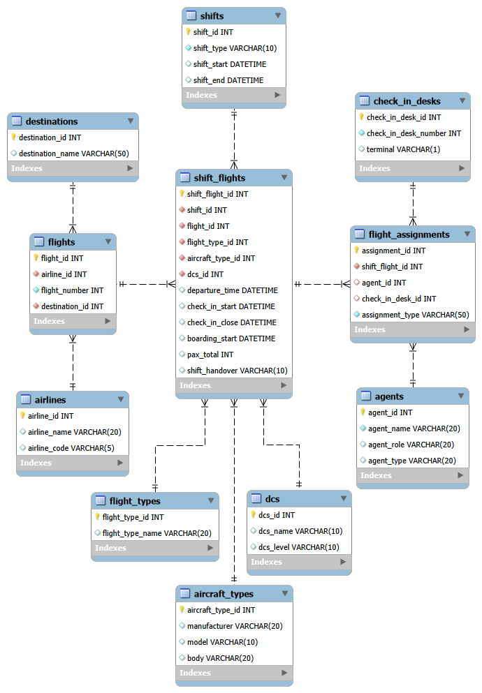

# Airport Workforce Analytics
**Pet-проект по анализу операционной деятельности международного аэропорта**  
Реальные анонимизированные данные о работе агентов регистрации и посадки за 1 месяц.
## О проекте
Идея основана на собственном опыте работы агентом в течение двух с половиной лет. Ежедневное наблюдение за операционными процессами сформировало вопросы о равномерности распределения нагрузки между сотрудниками смены, кто работает с наиболее сложными рейсами и насколько загружены стойки регистрации. Проект отвечает на эти вопросы с помощью данных. Для анализа выбран июнь как период высокого сезона.

*Термины, используемые в проекте: [Dictionary.md](Docs/Dictionary.md)*

## Цели
- Спроектировать реляционную БД с нуля
- Построить ETL-пайплайн (Excel → Python → MySQL → Power BI)
- Рассчитать описательные метрики
- Проверить 8 гипотез о распределении нагрузки между агентами
- Оценить неравенство нагрузки (CV) и проверить связи между метриками (Spearman)
- Сделать многостраничный дашборд в Power BI
- Сформулировать бизнес-рекомендации
## Ключевые инсайты
| № | Заключение |
|---|------------|
| 1 | Нагрузка распределена неравномерно. Разрыв в 19 рейсов и 1231 пассажиров при равном числе смен |
| 2 | Перерывы различаются, но не критично. Средний перерыв составляет от 78 до 107 минут, разрыв 29 минут|
| 3 | Пик нагрузки приходится на ночь с 02:00 до 05:59 (~1911 пассажиров) что, в 1.6 раза больше дневного пика |
| 4 | Конфликты стоек регистрации системны. 60% наложений происходит на 6 стойках (33, 34, 44, 45, 47, 49), до 30% рейсов на стойке |
| 5 | Стойки используются коллективно. Доля рейсов агента не более 18%, на каждой стойке работают 16–28 агентов, закрепления нет |
| 6 | Допуски к Medium и Expert DCS сконцентрированы у половины состава. 8 из 14 regular-агентов владеют 5+ системами, Expert DCS только у 5 |
| 7 | Extra-агенты оправданы, но назначаются неравномерно. 62% рейсов не хватает персонала даже с extra, при этом на 2% рейсов избыток |
| 8 | ... |

## Технологический стек
`MySQL` · `SQL` · `Python (pandas, scipy, matplotlib, seaborn)` · `Jupyter` · `Power BI` · `Excel` 
## Данные
**Источник:** бумажные расписания рейсов (14 смен).

 **Объём:** 696 рейсов, 56 агентов, 31 авиакомпания.
 
 **Структура:** 11 взаимосвязанных таблиц.
 
 **Особенность:** ручной ввод с фотографий →  анонимизация через Python (pandas) и Excel (ВПР).
 
## Процесс обработки

1. **Ручной ввод** — 696 рейсов перенесены с фотографий в Excel.

2. **Структурирование** — 10 взаимосвязанных листов (данные + справочники)

3. **Анонимизация и разделение столбцов** Python (pandas): [split_and_anon.ipynb](Python/split_and_anon.ipynb)
   - замена фамилий агентов на идентификаторы `A001 – A056` по словарю сопоставлений
   - разбивка составных ячеек (`Iva;Pet` - реальные фамилии агентов, сокращённые до 3 первых букв; `34;35;36` - стойки регистрации)  на отдельные столбцы через `str.split(';', expand=True)`

4. **Экспорт** — создание CSV для импорта в MySQL (Import Wizard + LOAD DATA INFILE).

5. **Нормализация** — устранение повторяющихся групп столбцов (check_in_agent_1...4, boarding_agent_1...2, check_in_desk_1...4) в таблице `shift_flights`. С помощью SQL-запросов (пункт 4 [create_db.sql](SQL/Creation_and_validation/create_db.sql)) создана дополнительная 11-я таблица `flight_assignments` для хранения назначений агентов и стоек на рейсы в нормализованном виде.

## Архитектура базы данных
База данных спроектирована с нуля с учетом бизнес-логики аэропорта и построена по схеме **«Снежинка» (Snowflake Schema)**.

SQL-запросы для создания базы данных: [create_db.sql](SQL/Creation_and_validation/create_db.sql) 

### Справочники
`agents` · `airlines` · `destinations` · `dcs` · `aircraft_types` · `flight_types` · `check_in_desks` · `shifts`
### Операционные таблицы
`flights`  · `shift_flights` · `flight_assignments` 

Все внешние ключи настроены, связи отображены на ER-диаграмме в MySQL Workbench.

*Полный словарь полей: [Data_dictionary.md](Docs/Data_dictionary.md)*

## Метрики и гипотезы
### Блок 1: Нагрузка и квалификация агентов
| № | Гипотеза | Суть | Результат | Запрос SQL |
|---|---|---|---|---|
| 1 | Нагрузка распределена неравномерно. Одни агенты обслуживают в разы больше пассажиров, чем другие | Общий рейтинг агентов + ранг | *Подтверждена частично.* Разрыв ~19 рейсов при равных сменах, критического разрыва нет | [01_agents_rank.sql](SQL/Metrics/01_agents_rank.sql) |
| 2 | Сложные и разнообразные рейсы закреплены за узкой группой агентов | Количество уникальных DCS и авиакомпаний у каждого агента | *Подтверждена.* Только 8 агентов владеют 5 DCS и 15+ авиакомпаниями | [02_dcs_airlines.sql](SQL/Metrics/02_dcs_airlines.sql) |
| 3 | Перерывы распределены неравномерно между агентами | Средняя длительность окна между рейсами у каждого агента | *Подтверждена частично.* Разница между максимальным и минимальным средним перерывом составляет 29 минут| [03_breaks.sql](SQL/Metrics/03_breaks.sql) |
| 4 | В ночную смену работают одни агенты, в дневную — другие | Количество рейсов и пассажиров у каждого агента в ночную и дневную смены | *Подтверждена.* Часть агентов имеет на 10-12 рейсов меньше именно в ночные смены  | [04_day_night_load.sql](SQL/Metrics/04_day_night_load.sql) |
| 5 | Привлечение extra-агентов не оправдано | Сравнение нагрузки regular и extra, норматив 1:50 | *Не подтверждена.* 62% рейсов нуждаются в дополнительных агентах. Избыток extra-агентов всего на 2% рейсов. | [05_extra_and_regular_1_50.sql](SQL/Metrics/05_extra_and_regular_1_50.sql) |
| 6 | Распределение нагрузки по пассажиропотоку неравномерно. Максимум пассажиров приходится на ночные часы | Самые загруженные 4-часовые периоды по пассажиропотоку | *Подтверждена*. Ночной пик: 02:00-05:59 ~1911 чел. Дневной пик: 10:00-13:59 ~1216 чел. | [06_peak_hours.sql](SQL/Metrics/06_peak_hours.sql) |
### Блок 2: Стойки регистрации
| № | Гипотеза | Суть | Результат | Запрос SQL |
|---|---|---|---|---|
| 7* | Конфликты стоек носят системный характер | Частота и закономерности двойных назначений рейсов на стойки | *Подтверждена.* Наложения рейсов носят системный характер на стойках № 33, 34, 44, 45, 47, 49 и составляют до 30% от всех рейсов на стойке| [07_desks_conflicts.sql](SQL/Metrics/07_desks_conflicts.sql) |
| 8 | Одни и те же агенты работают на самых загруженных стойках | Количество рейсов на каждой стойке и топ агентов на них | *Не подтверждена.* Ни один агент не превышает 18% рейсов на стойке. Стойки используются агентами равномерно| [08_check_in_desks.sql](SQL/Metrics/08_check_in_desks.sql) |
#### *Дополнительно:
При проверке гипотезы №7 «Конфликты/наложения стоек регистрации» было обнаружено, что регистрация рейса с id = 149 выполнялась на стойках 3 и 34, что невозможно. На фото расписания стойки указаны как 33;34. Данные были исправлены. Также была проведена валидация всех 696 рейсов, выявлено и исправлено 5 аномалий (0,7% от общего числа рейсов). 

SQL-запросы валидации и исправления данных: [validation.sql](SQL/Creation_and_validation/validation.sql)
### Блок 3: Статистическая проверка
| Метод | Результат | Код Python |
|---|---|---|
| Коэффициент вариации | | [CV.ipynb](Python/CV.ipynb) |
| Корреляция Спирмена | | [Spearman.ipynb](Python/Spearman.ipynb) |
## Результаты и бизнес-рекомендации

### Визуализация результатов **Дашборд Power BI:** 

*В файлах* [queries_for_dashboard.sql](SQL/Metrics/queries_for_dashboard.sql) и [DAX_measures.dax](PowerBI/DAX_measures.dax) *собраны SQL-запросы (описательные метрики) и меры, с помощью которых рассчитаны средние, минимальные и максимальные значения по сменам, пассажирам и рейсам, а также топ-10 направлений и типов ВС для последующей визуализации в Power BI.*

### Выводы
#### 1. Нагрузка распределена неравномерно, но не критично
При равных условиях (одинаковое число смен, только агенты, работающие в основном составе смены) разрыв между топ и аутсайдером составляет **19 рейсов** (76 у `A001` против 57 у `A014` и `A042`) и **~1231 зарегистрированных пассажиров** (4146 у `A001` против 2915 у `A005`).
Средний перерыв между рейсами внутри смены колеблется от **78 минут** `A055` до **107 минут** `A042`. Разрыв 29 минут. Это меньше, чем предполагалось изначально, но говорит о том, что перекос в перерывах существует.

***Гипотеза №1** "Нагрузка распределена неравномерно. Одни агенты обслуживают в разы больше пассажиров, чем другие" и **Гипотеза №3** "Перерывы распределены неравномерно между агентами" - **Подтверждены частично**.*

Из 14 агентов основного состава (с числом смен > 10):
- **8 агентов** (57%) владеют **5+ DCS** — `A026` (6), `A007, A011, A014, A028, A037, A042, A050` (по 5).
- **5 агентов** (36%) имеют допуск уровня **Expert DCS** — `A026` (2 системы), `A007, A014, A042, A054` (по 1).
- Базовый уровень Basic DCS (2 системы) есть у всех — это обязательный минимум.
- Medium DCS: от 0 `A001` до 3 `A011, A028, A037, A050`.

***Гипотеза №2** "Сложные и разнообразные рейсы закреплены за узкой группой агентов" - **Подтверждена**.*

Часть агентов работает преимущественно в дневные смены:

| Агент | День (рейсы) | Ночь (рейсы) | Разница (Д-Н) | Кол-во отработанных смен Д,Н |
|---|---|---|---|---|
| A014 | 31 | 26 | 5 | 7, 7 |
| A042 | 33 | 24 | ***9*** | 7, 7 |
| A054 | 36 | 26 | ***10*** | 7, 6 |
| A011 | 33 | 27 | *6* | 7, 6 |
| A050 | 35 | 25 | ***10*** | 7, 7 |
| A002 | 37 | 26 | ***9*** | 7, 6 |
| A036 | 40 | 28 | ***12*** | 7, 7 |
| A037 | 38 | 31 | *7* | 7, 7 |
| A028 | 39 | 34 | 5 | 7, 7 |
| A055 | 35 | 35 | ***0*** | 7, 6 |
| A001 | 37 | 39 | ***-2*** | 7, 7 |
| A007 | 34 | 36 | 2 | 7, 7 |

У топовых агентов (по общему кол-ву рейсов) `A001, A007, A055` одинаковое количество рейсов и в дневные и в ночные смены. В то время, как агенты `А042, А036` и `А050` имеют значительно меньше рейсов именно в ночные смены, при этом количество рейсов в дневные смены не превышает "ТОПов".

***Гипотеза №4** "В ночную смену работают одни агенты, в дневную — другие" - **Подтверждена**.*

#### 2. Extra-агенты оправданы, но назначаются неравномерно

Сравнение плановой потребности (норматив 1 агент на 50 пассажиров) с фактическим составом:

| Статус рейса | Рейсов | Доля |
|---|---|---|
| Нехватка даже с Extra | 417 | 61,7% |
| Укомплектован без Extra | 211 | 31,2% |
| Extra закрыли нехватку | 34 | 5,0% |
| Избыток агентов | 14 | 2,1% |

Extra-агенты **закрывают нехватку только в 5% случаев**. Ещё 2% — избыток. При этом 62% рейсов не хватает персонала даже с учётом extra.

Это значит, что extra-агенты привлекаются, но **не туда, где они нужны больше всего и не в том количестве**.

***Гипотеза №5** "Привлечение extra-агентов не оправдано" - **Не подтверждена**.*

#### 3. Пик нагрузки приходится на ночные смены
Самый загруженный 4-часовой интервал **02:00–05:59** ~1911 пассажиров за смену. Ночной пик объясняется массовыми вылетами в 06:00–09:00. Регистрация на них открывается за 3 часа — то есть в 03:00–06:00, что и создаёт концентрацию пассажиров в 02:00–05:59. Дневной пик **10:00–13:59** ~1216 пассажиров. Для сравнения: минимальный интервал **22:00–01:59** ~639 пассажиров, то есть в 3 раза меньше ночного пика.

***Гипотеза №6** "Распределение нагрузки по пассажиропотоку неравномерно. Максимум пассажиров приходится на ночные часы" - **Подтверждена**.*

#### 4. Конфликты стоек носят системный характер

Из 49 стоек конфликты (наложения регистраций двух рейсов на одну стойку в рамках одной смены) зафиксированы на **30 стойках**. Но 60% всех конфликтов приходится на 6 стоек:

| Стойка | Конфликтов | Всего рейсов | % Конфликтов |
|---|---|---|---|
| 47 | 19 | 63 | 30,2% |
| 33 | 14 | 60 | 23,3% |
| 34 | 14 | 61 | 23,0% |
| 45 | 12 | 79 | 15,2% |
| 44 | 11 | 78 | 14,1% |
| 49 | 11 | 66 | 16,7% |

Конфликты сконцентрированы не случайно. Стойки 45–47 обслуживают рейсы крупнейшего перевозчика, 33–36 базовую авиакомпанию, а 49 находится — на стыке нескольких перевозчиков. Наложения системны, потому что высокая частота рейсов одной авиакомпании создаёт конкуренцию за стойки.

Каждый третий рейс на стойке 47 проходит с наложением*.

*Наложение определяется по пересечению интервалов регистрации. Если два рейса регистрировались на одной стойке в разное время, но с одним агентом — это не конфликт, а плановая ротация. Такие случаи из анализа исключены.

***Гипотеза №7** "Конфликты стоек носят системный характер" - **Подтверждена**.*

#### 5. Стойки используются коллективно, закрепления нет

По всем стойкам с загрузкой >50 рейсов:
- Доля топ-агента на стойке — **9–18%**.
- На каждой стойке работают **16–28 агентов**.
- Среднее число рейсов на агента — **2,5–4,2**.

***Гипотеза №8** «Одни и те же агенты работают на самых загруженных стойках» - **Не подтверждена**.*

Но выявлено, что одни и те же агенты оказываются топ-1 на нескольких стойках — `A048` (стойки 51, 36), `A049` (32, 34), `A021`(49, 33), `A036` (50, 35),`A014` (48). Это не закрепление стоек, а следствие общей неравномерности нагрузки. 

#### 6.

### Рекомендации 

Текущая система распределения агентов нуждается в доработке. Анализ показал, что часть сотрудников систематически получает больше нагрузки, у одних агентов короткие перерывы, у других - длительные, а привлечение extra-агентов соответствует реальной потребности, но их назначение на рейсы происходит неравномерно.
В краткосрочной перспективе предлагается формализовать процесс назначения и усилить контроль за назначениями. Это позволит сгладить перекосы без значительных затрат.

#### Долгосрочное решение

**Разработка автоматизированной системы распределения нагрузки**

На основе данных за **12 месяцев (730 рабочих смен: длиной 12 часов с графиком 2/2 день-ночь-отсыпной-выходной)** предлагается создать и внедрить автоматическую систему распределения нагрузки, которая выполняет:
1. **Интеграция с системой пропусков** — при входе в аэропорт агент автоматически попадает в список работающих.
2. **Учёт допусков в реальном времени** — к ID агента привязаны DCS и авиакомпании, с которыми он имеет право работать.
3. **Автоматическое распределение** — система учитывает норматив (1 агент на 50 пассажиров) и требования ТК РФ (перерыв 1.5 часа).
4. **Прогнозирование нагрузки** — модель предсказывает пиковые часы и рекомендует оптимальное количество агентов в смену.
5. **Мгновенная адаптация** — при замене/болезни агента система перераспределяет нагрузку за секунды.

**Ожидаемый эффект:**
- Полная автоматизация планирования смен
- Исключение человеческого фактора
- Оптимизация затрат на extra-агентов
- Прозрачная система назначений без субъективного фактора
- Возможность анализа эффективности каждого агента

## Ограничения проекта
| № | Ограничение | Описание |
|---|-------------|----------|
| 1 | **Фокус на ресурсах** | Данные основаны на расписании и отражают распределение агентов и стоек. Информация о фактических задержках вылетов отсутствует. |
| 2 | **Горизонт анализа** | Данные охватывают только один месяц (июнь 2023). Этого достаточно для выявления локальных паттернов, но недостаточно для выводов о системной проблеме за год/сезон. |
| 3 | **Неполнота данных о сложности** | Отсутствуют данные о количестве багажа, сложности визовых проверок и других факторах (маломобильные пассажиры, несопровождаемые дети, VIP пассажиры), напрямую влияющих на время обслуживания пассажира. |
| 4 | **Отсутствие HR-данных** | В расписании нет информации об отпусках, отгулах, больничных, периодах дополнительного обучения и иных ограничениях по персоналу (в т.ч. беременность, что напрямую влияет на возможность работы агента в ночные смены). |
| 5 | **Человеческий фактор** | Данные вносились вручную с фотографий, что не исключает наличия случайных ошибок при переносе. Проведена валидация, найденные аномалии (0.7%) исправлены. |
| 6 | **Анонимизация** | Замена реальных имён, номеров рейсов, названий и кодов авиакомпаний делает невозможным прямое сравнение с другими открытыми данными об авиаперевозках. |

## Планы по развитию
- [ ] Перенести данные обо всех сменах и агентах в службе за **12 месяцев** для статистической значимости.
- [ ] Автоматизировать ETL-процесс с помощью Python (pandas + sqlalchemy).
