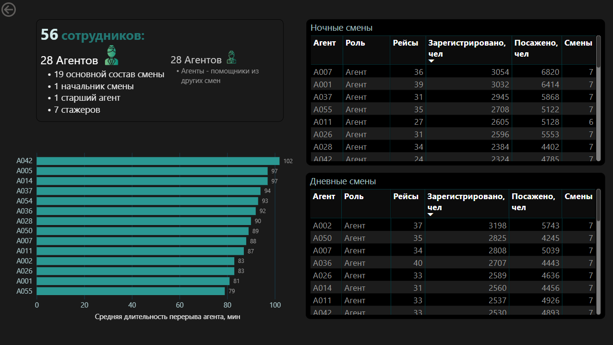
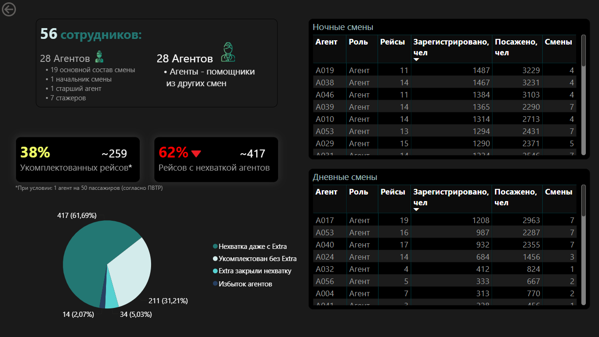
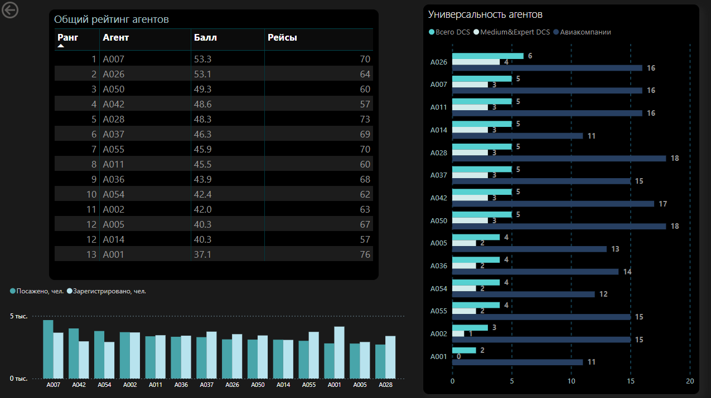
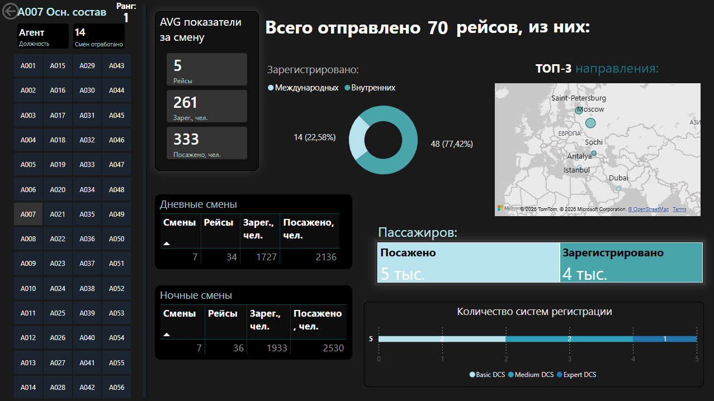
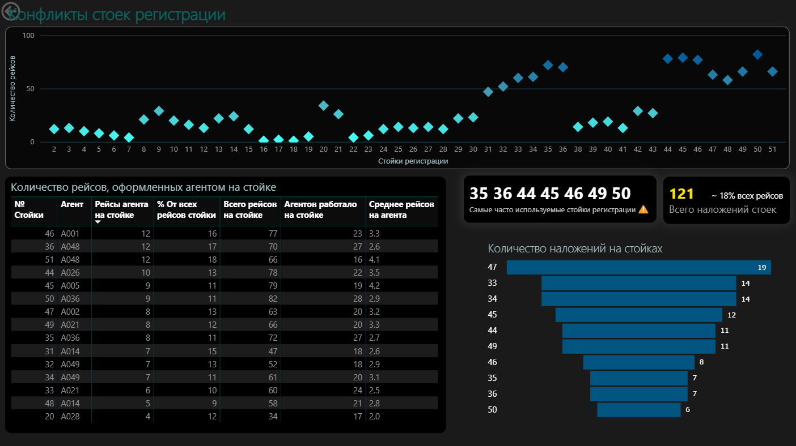
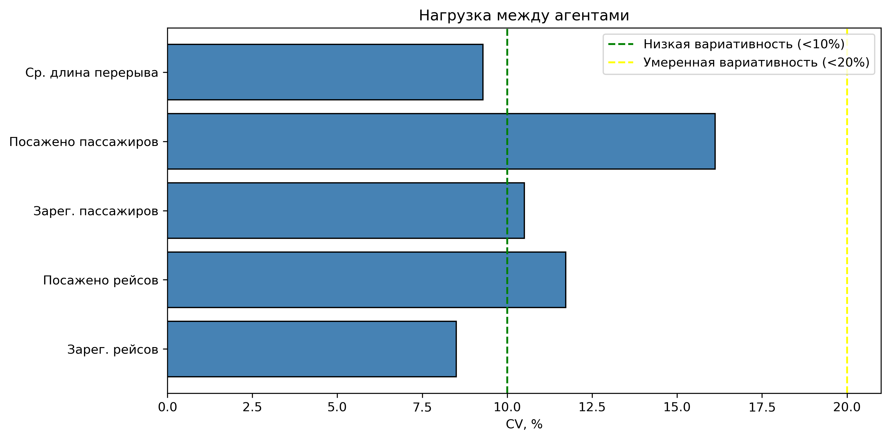

# Airport Workforce Analytics 
Анализ нагрузки агентов регистрации и посадки на основе анонимизированных операционных данных аэропорта за 1 месяц.

## Описание проекта
В проекте исследуется равномерность распределения нагрузки между сотрудниками и конфликты стоек регистрации. Для анализа выбран летний месяц, как период высокого пассажиропотока.

Исходные данные* были в виде фотографий бумажных расписаний рейсов (14 смен, 696 рейсов, 56 сотрудников).

***Особенность** проекта заключается в ручном вводе данных с фотографий с последующей полной анонимизацией с помощью Python (pandas) и Excel (ВПР).*
*Термины, используемые в проекте: [Dictionary.md](Docs/Dictionary.md)*.

*Исходные данные в репозитории не представлены.

### Стек
`MySQL` · `SQL` · `Python (pandas, matplotlib, seaborn)` · `Jupyter` · `Power BI` · `Excel` 

Основные задачи:
- Спроектировать реляционную БД
- Построить ETL (Excel - Python - MySQL - Power BI)
- Рассчитать описательные метрики
- Проверить 7 гипотез о распределении нагрузки между агентами
- Сделать многостраничный дашборд в Power BI
- Сформулировать бизнес-рекомендации

## Ключевые инсайты
- Нагрузка распределена неравномерно. Разрыв в 19 рейсов и 1231 пассажиров при равном числе смен.
- Длительность перерывов различается, но не критично. Разброс от 78 до 107 минут, разрыв 29 минут.
- Пик нагрузки приходится на ночь с 02:00 до 05:59 (~1911 пассажиров), что в 1,6 раза больше дневного пика.
- 55% конфликтов стоек происходит на 6 стойках. 
- Стойки используются коллективно. Доля рейсов агента не более 18%, на каждой стойке работают 16–28 агентов, закрепления нет.
- Допуски к Medium и Expert DCS имеются у половины состава.
- Привлечение дополнительных агентов оправдано, но на рейсы они назначаются неравномерно. 62% рейсов все равно не хватает персонала.
- CV (8,5–16,1%) разброс низкий и умеренный.

**Визуализация результатов:** [Дашборд Power BI](PowerBI/dashboard.pdf) ([DAX_measures.dax](PowerBI/DAX_measures.dax)).

<table>
  <tr>
    <td></td>
    <td></td>
  </tr>
  <tr>
    <td></td>
    <td></td>
  </tr>
  <tr>
    <td></td>
    <td></td>
  </tr>
</table>

## Процесс обработки
### 1. Подготовка данных
- Ручной ввод рейсов с фотографий в Excel
- Создание 10 взаимосвязанных листов
- Анонимизация и разделение столбцов Python (pandas): [split_and_anon.ipynb](Python/split_and_anon.ipynb)
   - замена фамилий агентов на идентификаторы `A001 – A056` по словарю сопоставлений
   - разбивка составных ячеек (`Iva;Pet` - фамилии агентов; `34;35;36` - стойки регистрации)  на отдельные столбцы
-  Экспорт CSV для импорта в MySQL (Import Wizard).
- Нормализация — устранение повторяющихся групп столбцов (check_in_agent_1...4, boarding_agent_1...2, check_in_desk_1...4) в таблице `shift_flights`. С помощью SQL-запросов (п.4 [create_db.sql](SQL/Creation_and_validation/create_db.sql)) создана дополнительная 11-я таблица `flight_assignments` для хранения назначений агентов и стоек на рейсы в нормализованном виде.

### 2. Создание БД
- База данных спроектирована с нуля с учетом бизнес-логики аэропорта и построена по схеме **«Снежинка» (Snowflake Schema)**.
- SQL-запросы для создания базы данных: [create_db.sql](SQL/Creation_and_validation/create_db.sql) 

**Справочники**

`agents` · `airlines` · `destinations` · `dcs` · `aircraft_types` · `flight_types` · `check_in_desks` · `shifts`

**Операционные таблицы**

`flights`  · `shift_flights` · `flight_assignments` 

Все внешние ключи настроены, связи отображены на ER-диаграмме в MySQL Workbench.

*Полный словарь полей: [Data_dictionary.md](Docs/Data_dictionary.md)*
### 3. Описательная статистика
Рассмотрены:

- **Пассажиры:**
  - среднее, максимум и минимум, медиана на рейс/смену (*AVG:* **`130` `6 489`**)
  - самые загруженные 4 часовые интервалы в дневную и ночную смены (**`02:00 - 06:00`** и **`10:00 - 14:00`**)
- **Рейсы:**
  - среднее, максимум и минимум, медиана на агента/смену *AVG:* **`56` `50`**)
  - ТОП-10 направлений (**`Москва` `Санкт-Петербург` `Сочи`**)
  - ТОП-10 воздушных судов (**`A320` `SU95` `B738`**)
- **Персонал:**
  - состав персонала по должностям (**`47 Агентов` `7 Стажеров` `1 Начальник смены` `1 Старший агент`**)
  - рабочее время (**`168 часов`**)

SQL запросы: [queries_for_dashboard.sql](SQL/Metrics/queries_for_dashboard.sql)

### 4. Операционные метрики
#### 4.1 Нагрузка и квалификация агентов
| № | Гипотеза | Суть | Результат | Запрос SQL |
|---|---|---|---|---|
| 1 | Нагрузка распределена неравномерно | Общий рейтинг агентов + ранг | *Подтверждена частично* | [01_agents_rank.sql](SQL/Metrics/01_agents_rank.sql) |
| 2 | Разнообразные рейсы закреплены за узкой группой агентов | Количество уникальных DCS и авиакомпаний у каждого агента | *Подтверждена* | [02_dcs_airlines.sql](SQL/Metrics/02_dcs_airlines.sql) |
| 3 | Перерывы распределены неравномерно | Средняя длительность перерыва каждого агента | *Подтверждена частично*| [03_breaks.sql](SQL/Metrics/03_breaks.sql) |
| 4 | В ночную смену работают одни агенты, в дневную — другие | Количество рейсов и пассажиров у каждого агента в ночную и дневную смены | *Подтверждена* | [04_day_night_load.sql](SQL/Metrics/04_day_night_load.sql) |
| 5 | Привлечение дополнительных агентов не оправдано | Сравнение нагрузки по нормативу 1:50 | *Не подтверждена* | [05_extra_and_regular_1_50.sql](SQL/Metrics/05_extra_and_regular_1_50.sql) |
| 6 | Распределение пассажиропотока неравномерно | Самые загруженные 4-часовые периоды по пассажиропотоку | *Подтверждена* | [06_peak_hours.sql](SQL/Metrics/06_peak_hours.sql) |

#### 4.2 Стойки регистрации
| № | Гипотеза | Суть | Результат | Запрос SQL |
|---|---|---|---|---|
| 7* | Конфликты стоек носят системный характер | Частота и закономерности двойных назначений рейсов на стойки | *Подтверждена* | [07_desks_conflicts.sql](SQL/Metrics/07_desks_conflicts.sql) |
| 8 | Одни и те же агенты работают на самых загруженных стойках | Количество рейсов на каждой стойке и ТОП агентов на них | *Не подтверждена* | [08_check_in_desks.sql](SQL/Metrics/08_check_in_desks.sql) |
#### *Дополнительно:
При проверке гипотезы №7 «Конфликты/наложения стоек регистрации» было обнаружено, что регистрация рейса с id = 149 выполнялась на стойках 3 и 34, что невозможно. На фото расписания стойки указаны как 33;34. Данные были исправлены. Также была проведена валидация всех 696 рейсов, выявлено и исправлено 5 аномалий (0,7% от общего числа рейсов). 

SQL-запросы валидации и исправления данных: [validation.sql](SQL/Creation_and_validation/validation.sql)
#### 5. Статистическая проверка
Для оценки неравномерности нагрузки рассчитан коэффициент вариации (CV) по пяти метрикам.  
Классические тесты (t-test, ANOVA) не применялись, так как выборка неслучайна (один аэропорт, один месяц).

Коэффициент вариации по пяти критериям: [CV.ipynb](Python/CV.ipynb) 

| Критерий | CV, % |
|---|---|
| Средняя длина перерыва | 9,3 |
| Посажено пассажиров | 16,1 |
| Зарегистрировано пассажиров | 10,5 |
| Посажено рейсов | 11,7 |
| Зарегистрировано рейсов | 8,5 |

Коэффициент вариации по всем критериям находится в диапазоне *8,5–16,1%*, что означает относительный разброс низкий и умеренный. Посадка распределена неравномернее, чем регистрация. CV по посаженным пассажирам 16,1% против 10,5% по зарегистрированным. По рейсам — 11,7% против 8,5%.

### Подробные выводы по гипотезам: [Results.md](Docs/Results.md)

### Рекомендации 

Текущая система распределения агентов нуждается в доработке. Анализ показал, что часть сотрудников систематически получает больше нагрузки, у одних агентов короткие перерывы, у других - длительные, а привлечение extra-агентов соответствует реальной потребности, но их назначение на рейсы происходит неравномерно.
В краткосрочной перспективе предлагается формализовать процесс назначения и усилить контроль за назначениями. Это позволит сгладить перекосы без значительных затрат.

**Долгосрочное решение**

**Разработка автоматизированной системы распределения нагрузки**

На основе данных за **12 месяцев (730 рабочих смен: длиной 12 часов с графиком 2/2 день-ночь-отсыпной-выходной)** предлагается создать и внедрить автоматическую систему распределения нагрузки, которая выполняет:
1. **Интеграция с системой пропусков** — при входе в аэропорт агент автоматически попадает в список работающих.
2. **Учёт допусков в реальном времени** — к ID агента привязаны DCS и авиакомпании, с которыми он имеет право работать.
3. **Автоматическое распределение** — система учитывает норматив (1 агент на 50 пассажиров) и требования ТК РФ (перерыв 1.5 часа).
4. **Прогнозирование нагрузки** — модель предсказывает пиковые часы и рекомендует оптимальное количество агентов в смену.
5. **Мгновенная адаптация** — при замене/болезни агента система перераспределяет нагрузку за секунды.

**Ожидаемый эффект:**
- Полная автоматизация планирования смен
- Исключение человеческого фактора
- Прозрачная система назначений без субъективного фактора

## Ограничения проекта
- Данные охватывают только один месяц
- Отсуствие данных о сложности (кол-во оформленного багажа, VIP пассажиры, несопровождаемые дети, визовые проверки и т.д.)
- Отсутствие HR данных об отпусках и больничных
- Ручной ввод данных
- Анонимизация делает невозможным прямое сравнение с другими открытыми данными об авиаперевозках

## Планы по развитию
- [ ] Перенести данные обо всех сменах и агентах в службе за **12 месяцев** для статистической значимости
- [ ] Автоматизировать ETL-процесс с помощью Python
